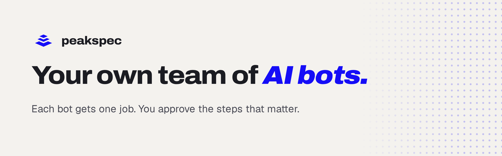

<a href="https://peakspec.xyz">
  <picture>
    <source media="(prefers-color-scheme: dark)" srcset="banner-dark.png">
    
  </picture>
</a>

**peakspec** sets up your own team of AI bots, on the AI plans you already have. Each bot gets its own name and one job, works with the apps you already run, and never sends, posts or moves a meeting without your OK. → [peakspec.xyz](https://peakspec.xyz)

### Open source

| Repo | What it does |
|---|---|
| **[marshal](https://github.com/peakspec/marshal)** | An open-source multi-agent PM-ops team for Claude Code: associate PM, GTM, QA and data-analyst subagents that run product work end to end |
| **[img2dot-peakspec](https://github.com/peakspec/img2dot-peakspec)** | Turn any image into peakspec's halftone-dot, pixel-grid or ASCII-ramp illustration style. Static HTML/CSS/JS, no build step |

### Talk to us

